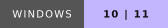
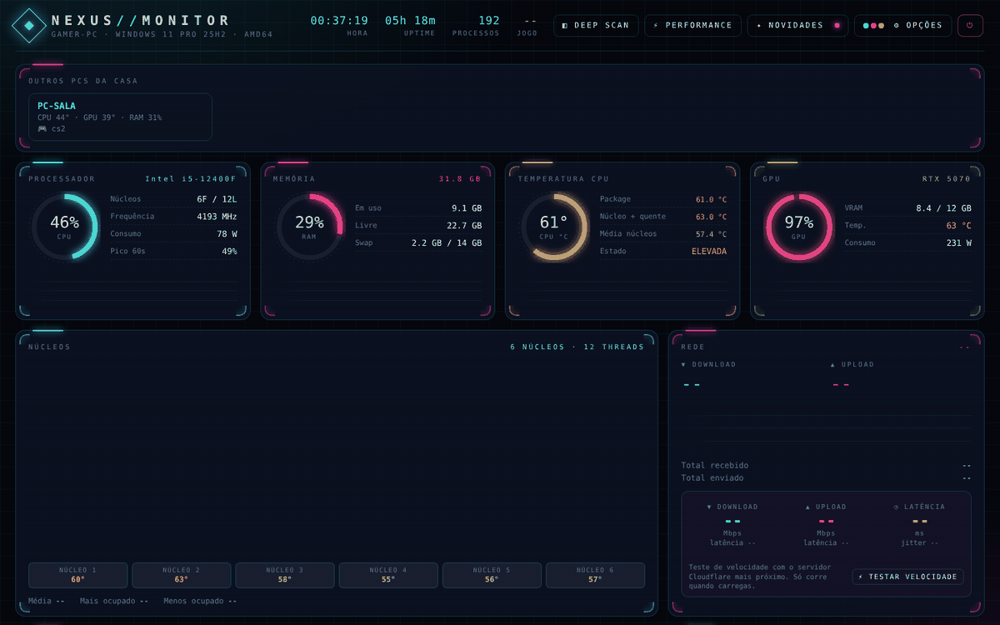
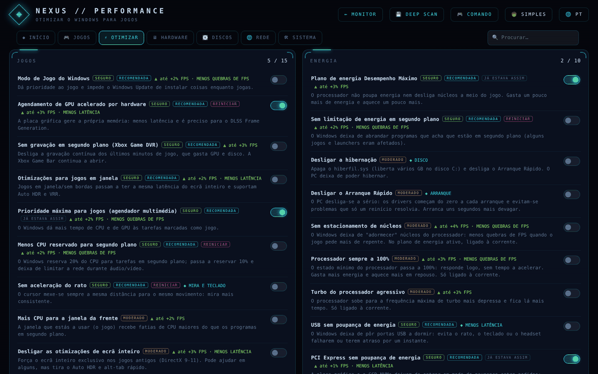
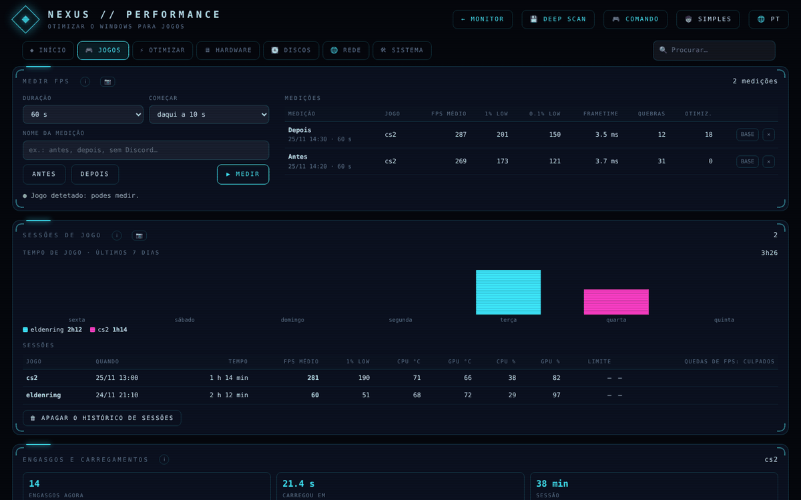
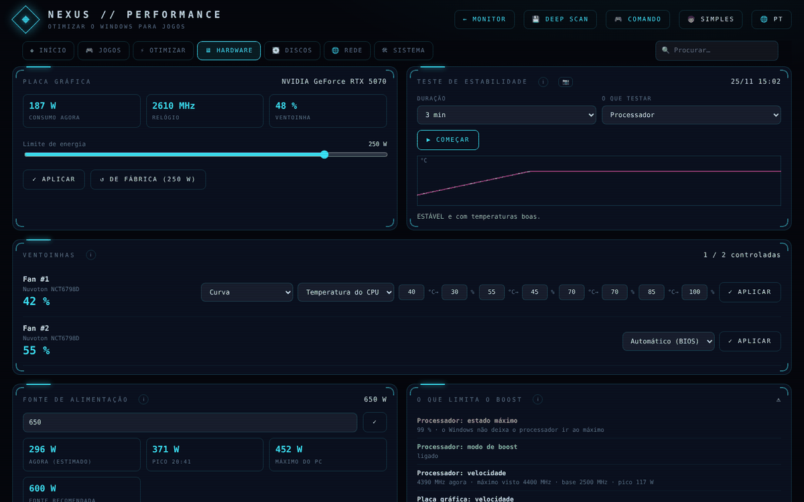
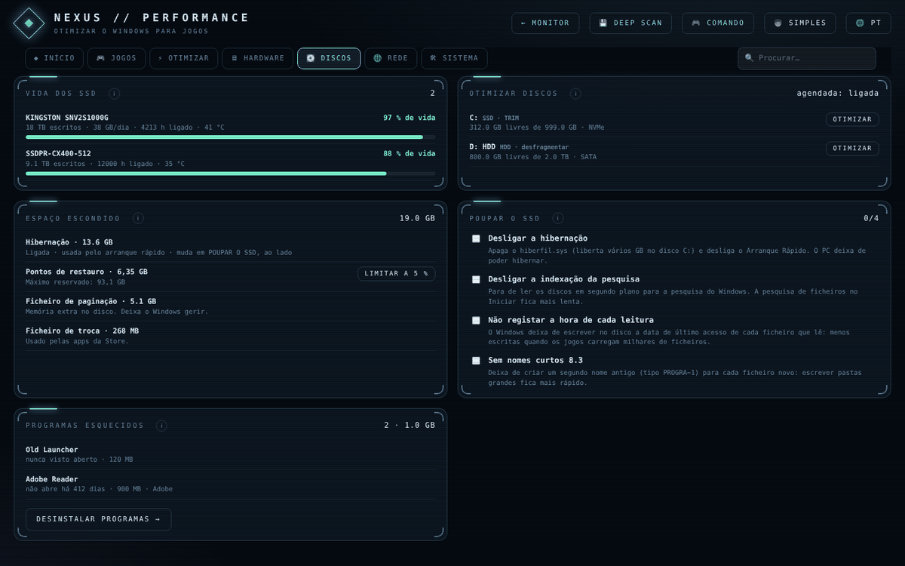

# ◈ NEXUS // MONITOR

**PC monitor, gaming optimisations and phone control — everything runs on your own PC.**

[**⬇ Download v2.4.2**](versoes/v2.4.2/NEXUS-Monitor-v2.4.2.zip?raw=1) · [Small update](versoes/v2.4.2/NEXUS-Monitor-v2.4.2-update.zip?raw=1) · [Changelog](CHANGELOG.md) · [FAQ](FAQ.md) · [Privacy](PRIVACY.md) · [Português](README.pt.md)

---

## What it is

NEXUS Monitor is a Windows app that shows everything happening on your PC in real time, on a good-looking page in your browser: processor, cores, RAM, graphics card, temperatures, fans, power, drives, network and **game FPS and latency**. It also has a **Performance** page with dozens of Windows optimisations (all explained and reversible), a **Deep Scan** for your drives, an **in-game overlay**, a **Stream Deck plugin** and **phone** access on your home network.

It's made for gamers but explained for people who don't know much about PCs: every card has an explanation, and the 🧒 **SIMPLE** button puts it in plain words.

## Highlights

| | |
|---|---|
| 📊 **Live monitor** | Per-core CPU, RAM, GPU, temperatures, fans, power, drives, network, processes and game FPS/1% low/frametime (PresentMon). |
| ⚡ **Performance** | Windows gaming optimisations with risk level, estimated gain and RESTORE; debloat; per-game profiles; FPS limit; game boost; stability test (CPU, RAM and GPU). |
| 🎮 **Games** | Sessions with FPS and bottleneck, stutters per minute, loading time per drive, close programs while gaming, active overlays, before/after benchmarks. |
| 🖥 **Hardware** | Power supply (is it enough?), what limits boost, upgrade simulator, inventory with warranties, fans (curves and pump protection), BIOS and drivers. |
| 💽 **Drives** | SSD health and life, speed, optimise (TRIM/defrag), hidden space, duplicates, cleanup and a leftover-free uninstaller. |
| 🌐 **Network** | Continuous ping, best DNS, speed and bufferbloat tests, Wi-Fi, who's using the internet, game network priority, Wake-on-LAN. |
| 🔒 **System** | Windows security, version and end of support, updates (uninstall one), crashes explained, Windows repair, boot time. |
| 📱 **Phone** | Dashboard on your phone (home-screen app), gamepad for the PC, launch games, shut down when a download finishes. Each phone must be accepted on the PC. |
| 🎛 **Stream Deck** | Keys with live graphs, NEXUS actions and music with the cover of what's playing. |

<table>
<tr>
<td></td>
<td></td>
</tr>
<tr>
<td></td>
<td></td>
</tr>
</table>

Screenshots with sample data, interface in Portuguese (it switches to your language).

## Install

1. Download **[NEXUS Monitor v2.4.2.zip](versoes/v2.4.2/NEXUS-Monitor-v2.4.2.zip?raw=1)**.
2. Right-click the zip → **Extract All…** (don't run anything from inside the zip).
3. Open the folder and double-click **`INSTALL NEXUS.bat`**.
4. Pick the folder (or keep the suggested one), the optional extras and accept the administrator prompt. The installer speaks your Windows language.

The installer compiles NEXUS on your own PC (with the .NET compiler that ships with Windows) and downloads LibreHardwareMonitor to read the sensors. Optional extras: PresentMon (FPS), gdu (Deep Scan) and the Stream Deck plugin.

**Requirements:** Windows 10 or 11 (64-bit), .NET Framework 4.8 (included with Windows), internet connection during install.

## Update

- **From NEXUS itself:** it checks for new versions when it opens and every hour and shows what changes. Press **INSTALL** and it does the rest (it verifies the download's SHA-256 first).
- **By hand:** if you have one of the two previous versions, download the **[small update](versoes/v2.4.2/NEXUS-Monitor-v2.4.2-update.zip?raw=1)**, extract it and run `UPDATE NEXUS.bat`. Otherwise use the full zip.

Update checks can be turned off in **Options → General**. Every version is in [`versoes/`](versoes).

## Privacy

Nothing leaves your PC: no accounts, ads, telemetry or NEXUS servers. The only internet connections are the ones you ask for (speed test, ntfy notifications) and the update check against this repository, which can be turned off. Details in **[PRIVACY.md](PRIVACY.md)**.

## FAQ

Full questions and answers: **[FAQ.md](FAQ.md)**. The most common ones:

<b>My antivirus says it's dangerous. Is it?</b>

NEXUS is compiled on your PC from the source code in the zip (you can read it in the `codigo` folder). New, unsigned programs are sometimes flagged by mistake by automatic analysis. If that happens, submit the file to Microsoft as a false positive and let us know in an [issue](../../issues).

<b>Can the optimisations break Windows?</b>

Each one shows its risk, and NEXUS saves the original value before changing anything. **RESTORE** puts it back exactly as it was. A Windows restore point is created before applying (at most one per day).

<b>No temperatures or fans show up.</b>

Make sure NEXUS runs as administrator and the sensor mode is "Complete" (Options → General). Some motherboards don't allow reading certain fans.

<b>How do I uninstall?</b>

In NEXUS: **Options → General → Uninstall** (or the menu of the icon next to the clock). Also in **Windows Settings → Apps** or with `UNINSTALL NEXUS.bat` in the NEXUS folder. If you want Windows exactly as before, press **RESTORE** on the Performance page first.

## License

[MIT](LICENSE): you can use, copy, change and share NEXUS freely, as long as you keep the license notice. Components downloaded during install (LibreHardwareMonitor, PawnIO, PresentMon, gdu) have their own licenses.

## Issues and ideas

Found a bug or have an idea? Open an [issue](../../issues/new/choose). For bugs, include the version (bottom of the dashboard), your Windows version and what happened.

---

NEXUS Monitor · <a href="CHANGELOG.md">version history</a>

