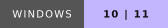
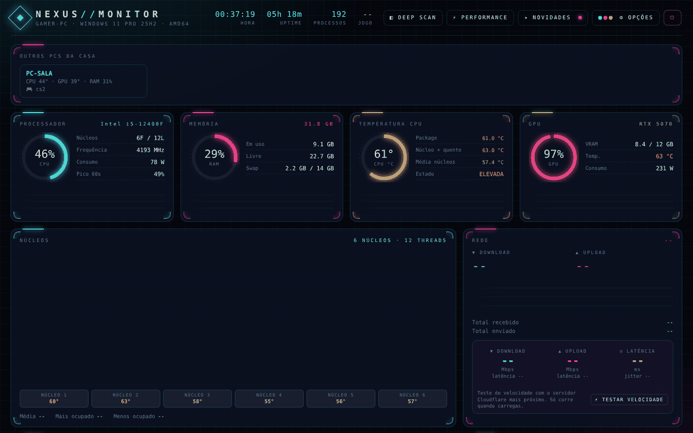
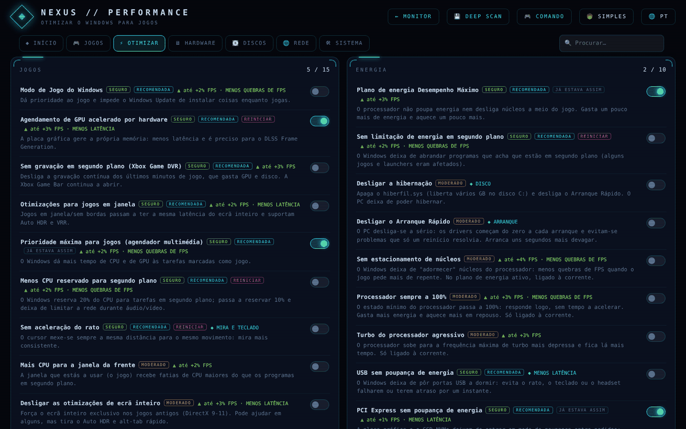
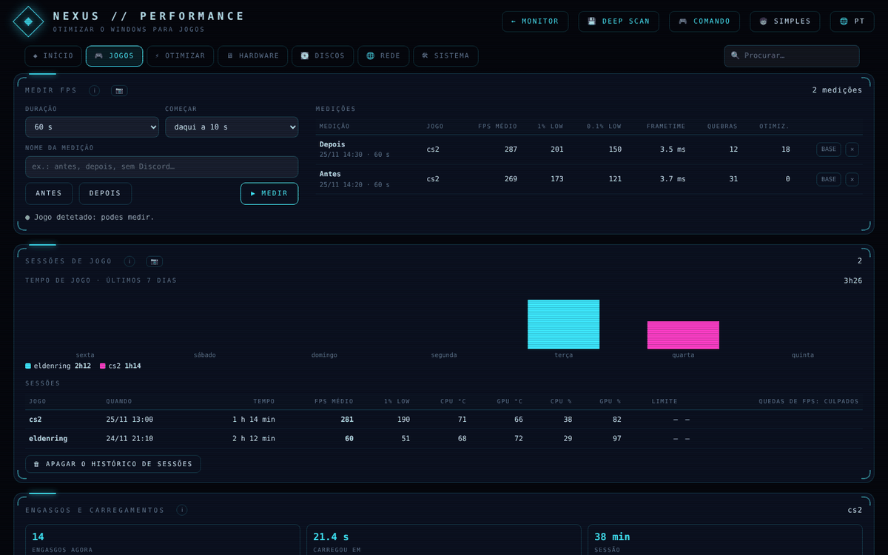
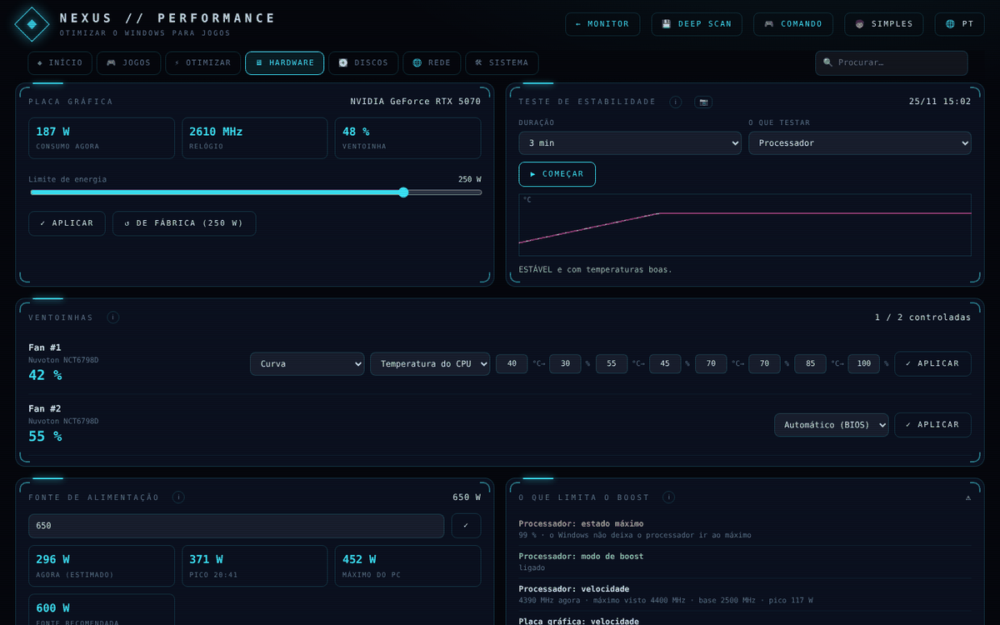
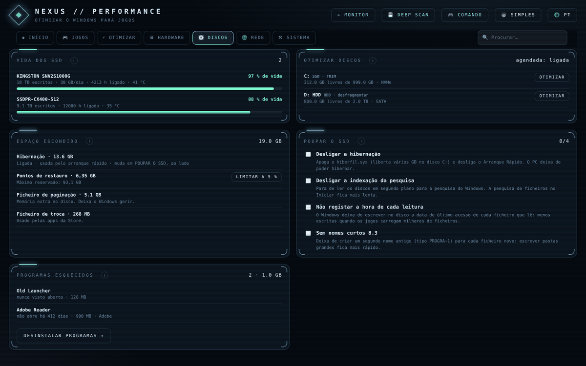

# ◈ NEXUS // MONITOR

**Monitor do PC, otimizações para jogos e controlo pelo telemóvel — tudo a correr só no teu PC.**

[**⬇ Transferir v2.5.4**](versoes/v2.5.4/NEXUS-Monitor-v2.5.4.zip?raw=1) · [Atualização pequena](versoes/v2.5.4/NEXUS-Monitor-v2.5.4-update.zip?raw=1) · [Novidades](CHANGELOG.pt.md) · [Perguntas](FAQ.pt.md) · [Privacidade](PRIVACIDADE.md) · [English](README.md)

---

## O que é

O NEXUS Monitor é uma app para Windows que mostra, em tempo real e numa página bonita no browser, tudo o que se passa no PC: processador, núcleos, RAM, placa gráfica, temperaturas, ventoinhas, consumo, discos, rede e os **FPS e a latência dos jogos**. Junta uma página de **Performance** com dezenas de otimizações do Windows (todas explicadas e reversíveis), um **Deep Scan** para os discos, um **overlay em jogo**, um **plugin para a Stream Deck** e acesso pelo **telemóvel** na rede de casa.

É feito para quem joga, mas explicado para quem não percebe de PCs: cada cartão tem uma explicação, e o botão 🧒 **SIMPLES** mostra-a em linguagem de criança.

## Destaques

| | |
|---|---|
| 📊 **Monitor ao vivo** | CPU por núcleo, RAM, GPU, temperaturas, ventoinhas, consumo, discos, rede, processos e FPS/1% low/frametime dos jogos (PresentMon). |
| ⚡ **Performance** | Otimizações do Windows para jogos com risco, ganho estimado e REPOR; debloat; perfis por jogo; limite de FPS; boost de jogo; teste de estabilidade (CPU, RAM e GPU). |
| 🎮 **Jogos** | Sessões com FPS e gargalo, engasgos por minuto, tempo de carregamento por disco, fechar programas ao jogar, overlays ativos, medições antes/depois. |
| 🖥 **Hardware** | Fonte de alimentação (chega?), o que limita o boost, simulador de upgrade, inventário com garantias, ventoinhas (curvas e proteção da bomba de água), BIOS e drivers. |
| 💽 **Discos** | Saúde e vida dos SSD, velocidade, otimizar (TRIM/desfragmentar), espaço escondido, duplicados, limpeza e desinstalador sem restos. |
| 🌐 **Rede** | Ping contínuo, melhor DNS, teste de velocidade e de bufferbloat, Wi-Fi, quem usa a internet, prioridade de rede para o jogo, Wake-on-LAN. |
| 🔒 **Sistema** | Segurança do Windows, versão e fim do suporte, atualizações (desinstalar uma), crashes explicados, reparar o Windows, tempo de arranque. |
| 📱 **Telemóvel** | Painel no telemóvel (app no ecrã principal), comando para o PC, abrir jogos, desligar quando um download acaba. Cada telemóvel é aceite no PC. |
| 🎛 **Stream Deck** | Teclas com gráficos ao vivo, ações do NEXUS e música com a capa do que está a tocar. |

<table>
<tr>
<td></td>
<td></td>
</tr>
<tr>
<td></td>
<td></td>
</tr>
</table>

Imagens com dados de exemplo.

## Instalar

1. Transfere **[NEXUS Monitor v2.5.4.zip](versoes/v2.5.4/NEXUS-Monitor-v2.5.4.zip?raw=1)**.
2. Botão direito no zip → **Extrair tudo…** (não corras nada de dentro do zip).
3. Abre a pasta e faz duplo clique em **`INSTALL NEXUS.bat`**.
4. Escolhe a pasta (ou deixa a sugerida), os extras opcionais e aceita o pedido de administrador. O instalador fala a língua do Windows.

O instalador compila o NEXUS no próprio PC (com o compilador do .NET que já vem com o Windows) e descarrega o LibreHardwareMonitor para ler os sensores. Extras opcionais: PresentMon (FPS), gdu (Deep Scan) e o plugin da Stream Deck.

**Requisitos:** Windows 10 ou 11 (64 bits), .NET Framework 4.8 (já vem com o Windows), ligação à internet na instalação.

## Atualizar

- **Pelo próprio NEXUS:** ele procura versões novas ao abrir e de hora a hora e mostra o que muda. Carregas em **INSTALAR** e trata de tudo (confirma o SHA-256 do download antes de instalar).
- **À mão:** se tens uma das duas versões anteriores, transfere a **[atualização pequena](versoes/v2.5.4/NEXUS-Monitor-v2.5.4-update.zip?raw=1)**, extrai e corre `UPDATE NEXUS.bat`. Se não, usa o zip completo.

A verificação de atualizações pode ser desligada em **Opções → Geral**. Todas as versões estão em [`versoes/`](versoes).

## Privacidade

Nada sai do teu PC: não há contas, anúncios, telemetria nem servidores do NEXUS. As únicas ligações à internet são as que pedes (teste de velocidade, notificações ntfy) e a verificação de atualizações neste repositório, que se pode desligar. Detalhes em **[PRIVACIDADE.md](PRIVACIDADE.md)**.

## Perguntas frequentes

Todas as perguntas e respostas: **[FAQ.pt.md](FAQ.pt.md)**. As mais comuns:

<b>O antivírus diz que é perigoso. É?</b>

O NEXUS é compilado no teu PC a partir do código que vem no zip (podes lê-lo na pasta `codigo`). Programas novos e sem assinatura às vezes são marcados por engano pela análise automática. Se acontecer, envia o ficheiro à Microsoft como falso positivo e diz-nos numa [issue](../../issues).

<b>As otimizações podem estragar o Windows?</b>

Cada uma mostra o risco, e o NEXUS guarda o valor original antes de mudar. **REPOR** volta exatamente ao que estava. Antes de aplicar, é criado um ponto de restauro do Windows (no máximo um por dia).

<b>Não aparecem temperaturas ou ventoinhas.</b>

Confirma que o NEXUS corre como administrador e que o modo de sensores é o "Completo" (Opções → Geral). Algumas placas-mãe não deixam ler certas ventoinhas.

<b>Como desinstalo?</b>

No próprio NEXUS: **Opções → Geral → Desinstalar** (ou no menu do ícone junto ao relógio). Também em **Definições do Windows → Aplicações** ou com `UNINSTALL NEXUS.bat` na pasta do NEXUS. Se quiseres o Windows como estava, carrega antes em **REPOR** na Performance.

## Licença

[MIT](LICENSE): podes usar, copiar, alterar e partilhar o NEXUS à vontade, desde que mantenhas o aviso de licença. Os componentes descarregados na instalação (LibreHardwareMonitor, PawnIO, PresentMon, gdu) têm as licenças deles.

## Problemas e ideias

Encontraste um erro ou tens uma ideia? Abre uma [issue](../../issues/new/choose). Para erros, junta a versão (canto inferior do painel), o Windows que usas e o que aconteceu.

---

NEXUS Monitor · <a href="CHANGELOG.pt.md">histórico de versões</a>

